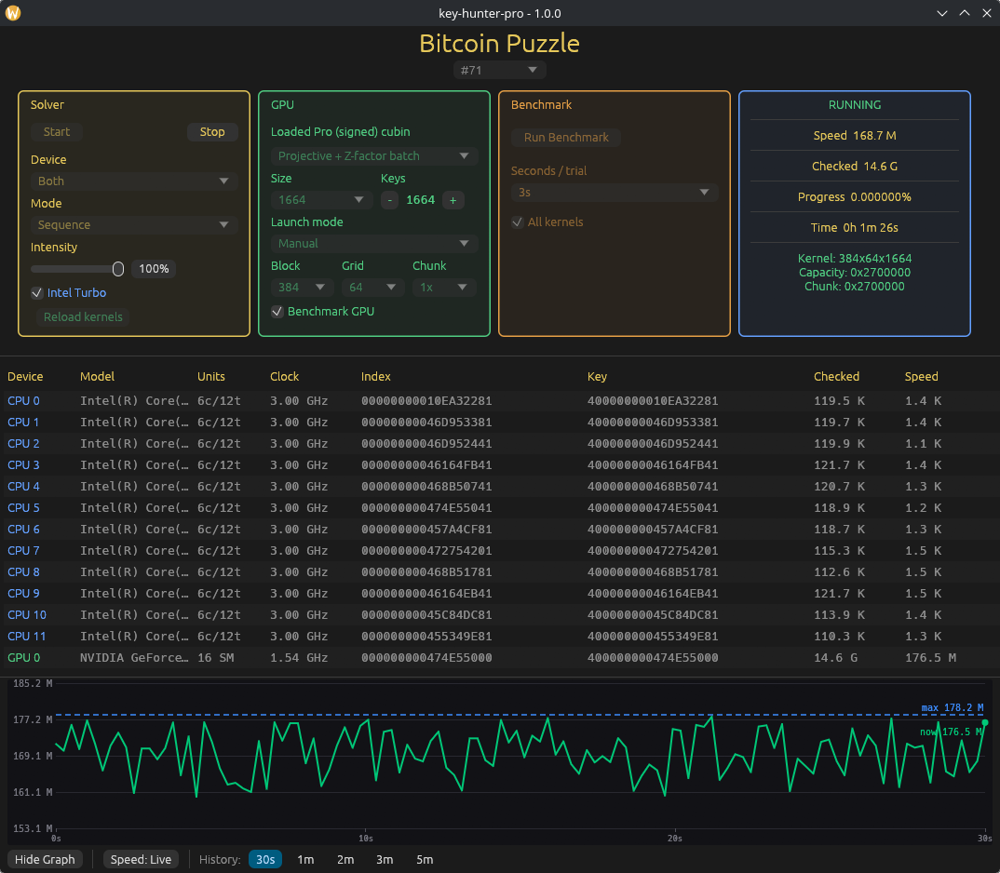

# Puzzle Hunter Pro (PHP)

### Specialized Pro solver for the "1000 BTC Bitcoin Puzzle"

**Free host application. Commercial high-performance CUDA kernels.**

The 1000 BTC Puzzle (created in 2015 by saatoshi_rising) remains still unsolved. The search space is enormous. PHP was written from the ground up as a specialized engine for these exact ranges: a native Rust host, a large private family of CUDA kernels, and a coordinated work allocator that does not waste keys.

If you are going to spend electricity looking for a key, use a tool that was designed for this problem.

> [!IMPORTANT]
> This is a specialized solver for the public 1000 BTC Puzzle ranges only.
> It is **not** a generic vanity address generator nor a multi-coin hunter nor a brute-forcer.

---

## What this application does

PHP is a native desktop application (Rust + egui) that searches the unsolved ranges of the public 1000 BTC Puzzle.

- **Puzzle range**: any unsolved puzzle from **#71 to #160**
- **Host**: free, open for inspection, runs on CPU fully and on GPU once a licensed kernel package is loaded
- **Kernels**: commercial, closed-source, compiled and locked to your specific machine
- **Goal**: maximum useful keys per watt on the exact problem that still has a large remaining reward

See the  file.

---

## Why it is different

### 1. Purpose-built for the 1000 Bitcoin Puzzle

PHP carries a large private family of CUDA kernels written specifically for sequential and specialized search of these ranges:

- Projective forms (AddG lazy, XZ batch, Z-factor batch, X-only, Baby-step variants, restricted/lattice GLV paths)
- Jacobian forms (baseline, Co-Z / Meloni, Karatsuba field mul, linear and endomorphism GLV variants)
- Chudnovsky variants
- XYZZ
- XZ differential (x-only style)

Different kernels expose different trade-offs between arithmetic intensity, memory pressure, and power draw. The host lets you select kernel family and batch size and run a built-in benchmark so you can find strong launch parameters on *your* hardware.

### 2. Coordinated work allocator (no wasted keys)

A single global work allocator hands out ranges to every worker - CPU threads and GPU launches - from the same persistent queue.

- No overlapping ranges
- No silently skipped keys
- Progress is written to disk
- Restart after a crash, power loss, or reboot and continue exactly where you stopped
- Separate state per puzzle and per search mode

> [!TIP]
> This is one of the most important parts of the design for long-running searches.
> Leave the program running for days, stop it, reboot, and resume without manual bookkeeping.

### 3. ALL mode - round-robin across every unsolved puzzle

In addition to selecting a single puzzle, the GUI offers **ALL**.

When ALL is selected the host:

1. Walks the list of remaining unsolved puzzles (from the lowest number upward)
2. Gives each puzzle a fixed budget of allocator time (5, 10, 15, 30 or 60 seconds)
3. Moves to the next unsolved puzzle
4. After the last one, starts a new sweep from the beginning

> [!NOTE]
> Progress for the current sweep, current puzzle, and completed sweeps is shown in the dashboard. Cycle state is persisted so a restart continues the rotation correctly.

### 4. Search modes

- **Sequence** - classic linear scan through the range
- **PCG** - scrambled order derived from a machine-bound Permuted Congruential Generator (different machines explore different orders)

Both modes use the same allocator and progress system.

### 5. CPU + GPU together

You can run:

- CPU only
- GPU only (once a kernel package is loaded)
- Both at the same time under the shared allocator

CPU workers and GPU workers pull from the same global queue so the combined search stays coherent.

### 6. Machine-locked kernel packages

Full-speed CUDA kernels are delivered as `.OWL` packages:

- Encrypted with a key derived from your hardware fingerprint
- GPG-signed so the host can verify origin
- Bound to the machine that generated the license request
- Loaded only if the current fingerprint matches

> [!WARNING]
> Sharing the `.OWL` package with another machine will not work.

---

## What the free host gives you

- Complete native GUI (egui)
- Full multi-threaded CPU solver
- GPU pipeline ready - load a licensed package when you want full speed
- Puzzle selector (individual puzzles or ALL)
- Search mode selector (Sequence / PCG)
- Live dashboard: progress, speed, current position, worker table, ALL-mode sweep status
- Built-in GPU benchmark / parameter hill-climb
- Persistent progress and clean resume
- License request flow (collects machine fingerprint + GPU info, builds an encrypted payload you email after payment)

> [!NOTE]
> There is a **GPU demo** available upon request.

---

## How the commercial kernels are obtained

1. Run the free host and open the Buy / License flow.
2. Accept the terms, choose payment coin, send coins, enter your email and transaction ID.
3. The application generates an **encrypted license request** that contains your hardware fingerprint, GPU details, and payment reference.
4. Send the request.
5. After the on-chain payment is verified, a machine-locked `.OWL` package is compiled for your architecture and sent back to your email.
6. Load the package in the application. It only decrypts and runs on the matching machine.

> [!IMPORTANT]
> One license = one machine.
> Additional machines require additional licenses.

---

## Installation

Please follow the following tutorial: [How to install](./INSTALLATION.md)

---

## What this is not

- Not a generic vanity or multi-address tool
- Not an online service or pool
- Not open-source kernels
- Not guaranteed to find a key (the ranges are large; the software improves the rate at which you search them)

---

# Blog post

If you are interested in reading a long post how this project started, here you can read more:

- [Puzzle Hunter Pro](https://control-owl.github.io/blog/post/2026/11/16/puzzle-hunter-pro.html)
- [Key Hunter (old version)](https://control-owl.github.io/blog/post/2026/10/09/key-hunter.html)

and more...

[https://control-owl.github.io/](https://control-owl.github.io/)

---

## Bottom line

Puzzle Hunter Pro exists because searching the remaining 1000 BTC Puzzle ranges with generic tools is expensive in both time and electricity. The free host lets anyone verify the pipeline and run serious CPU work. The commercial kernels are a private family of highly tuned CUDA implementations delivered only as machine-locked packages.

Built for the Puzzle. Nothing else!
